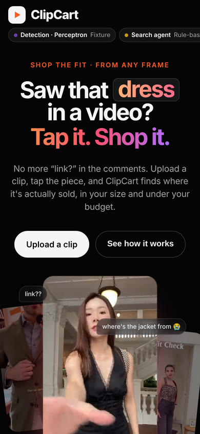
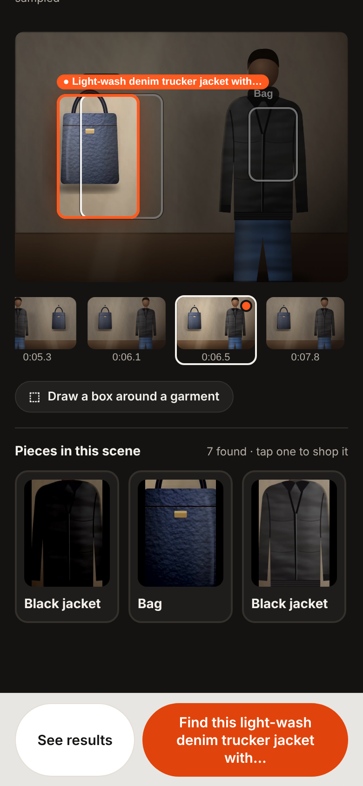
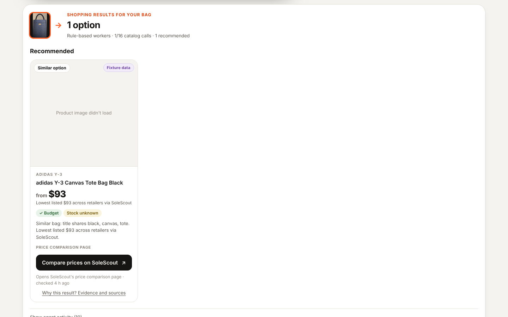
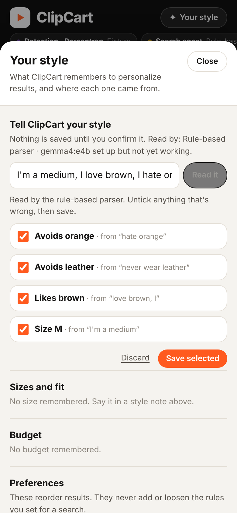
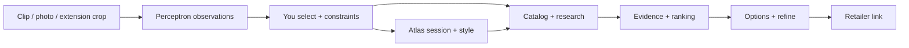

# ClipCart

> "I see it, I like it, I want it, I got it"

You see a jacket in a video. The comments say *link?* and nobody has one. Screenshots pile up. Search bars fill with guesses. Twelve tabs later, you’re still not sure if that bomber even exists under $120.

So we built ClipCart. **Send us a look.** Your shopping agent finds the original, searches alternatives, and brings back options that fit your budget.

Ashwin and Vinay built it at **DubHacks ’26**. ClipCart is a web shopping studio with a Chrome extension for capturing frames where you already watch.

[Run locally](#run-it) · [How it flows](#how-it-flows) · [What we won’t claim](#what-we-wont-claim)

| See a look | Pick the piece | Shop the match | Keep your style |
|:---:|:---:|:---:|:---:|
|  |  |  |  |

## The problem

Fashion discovery lives in video. Fit checks, street style, runway clips — the thing you want is on screen for two seconds, then gone.

Today’s path looks like this:

1. Pause. Screenshot. Crop by hand.
2. Guess a brand, color, and cut.
3. Search Google, Depop, Grailed, SSENSE, and hope.
4. Open every listing that *kind of* matches.
5. Re-check price, size, and whether it’s actually leather.

That workflow is slow, noisy, and easy to get wrong. Reverse-image search often fails on fashion. Comments rarely have the real link. And nothing in that loop remembers that you said **no leather, medium, under $120**.

## The solution

ClipCart turns a frame into a shopping brief, then runs bounded agents against real catalogs — with your constraints attached the whole way.

```text
  clip / photo / frame
           │
           ▼
   Perceptron sees the garment
           │
           ▼
   you pick the piece + set rules
           │
           ▼
   Grok searches original + alternatives
           │
           ▼
   evidence-backed listings you can open
```

**Product promise:** send us a look → get the original when we can prove it → get alternatives when we can’t or it doesn’t fit → leave for the retailer when you’re ready.

We don’t pretend a screenshot is a purchase. We don’t invent brands from a blurry logo. We don’t hide uncertainty.

## One clip with ClipCart

You’re watching a fit check. You want the jacket. Budget is $120. Size medium. No leather.

**You capture the frame.** Pause the video, click the Chrome extension, crop the jacket, and open ClipCart. Or upload a photo / short clip directly. The studio keeps the source context with the capture.

**You pick the piece.** Perceptron finds jackets, tops, bags, and accessories — boxes, colors, cuts, visible text. Click the one you mean, or use **Find in video** to describe it. If detection misses it, draw the box yourself. Search only runs on what you selected.

**You set the rules.** Budget, size, color, material exclusions. Hard constraints stay hard when the agent looks for options.

**ClipCart shops for you.** Catalog search returns initial options. **Research more offers** can dispatch a Grok Bot job across retailer and resale pages. Listings come back with price, image, retailer link, and a match label — verified, likely, or similar — so a lookalike never pretends to be the exact item.

**You refine.** “Same jacket, but black.” Unspecified preferences stick. Opening a result takes you to the retailer. Checkout happens there.

**You keep what matters.** Save what you like. Hide what you don’t. Style memory turns that into soft ranking hints — never overrides for budget or exclusions.

| Without ClipCart | With ClipCart |
|---|---|
| Guess search terms from memory | Crop the actual garment |
| Manual tab-hopping across sites | Bounded original + alternatives search |
| Constraints live in your head | Budget, size, materials enforced in ranking |
| “Looks close” sold as exact | Match labels tied to evidence |

## Built with Perceptron, Grok, and real listings

Each piece does a job we couldn’t fake with a pretty UI alone.

### Perceptron sees the garment

**Perceptron mk1.5** turns pixels into a shopping brief: category, color, pattern, cut, and readable logos when they’re actually readable. It supplies observations — not invented product identity. “Black bomber, ribbed collar, gold-tone zips” is useful. A tiny unreadable mark is not a brand claim.

### Grok does the shopping work

**Grok-powered workers** (and optional **Grok Bot** research) take that brief plus your constraints and hunt the original and alternatives. Tool calls return real listing references. Animation without retrieval doesn’t count.

### Catalogs keep the receipts honest

**SoleScout** supplies live product evidence — titles, images, prices, URLs. Prices and links are tied to what the provider actually returned. Unknown size or stock stays labeled unknown. Over-budget originals can surface as “found, doesn’t fit the budget” instead of vanishing.

### Atlas remembers the session

**MongoDB Atlas** stores the session, garment observations, preferences, listing evidence, and results so a refresh doesn’t wipe the work. Style memory learns from what you save and hide — soft ranking hints that never override hard constraints.

## How it flows



Optional paths on the same backend: **Grok Voice** for hands-free refine, **Photon** for iMessage entry, and a controlled **Solana** demo-merchant checkout with a compressed NFT receipt. The core promise stays the same — frame to listings — even when those extensions are off.

## What we won’t claim

- Exact brand identity from appearance alone
- Universal coverage of every video or retailer
- In-app purchase of third-party inventory
- That a save, click, or similar match is a verified buy

Fixtures and labeled modes exist for development. Live demos use real provider calls and say so.

## Run it

Requirements: **Python 3.11+**, **Node 20+**, **npm**, and **ffmpeg / ffprobe** on your `PATH`.

```bash
git clone https://github.com/JustGooogleIt/clipcart.git
cd clipcart
cp .env.example .env   # Perceptron / Atlas / research keys when you have them
bash scripts/dev.sh    # UI + API at http://127.0.0.1:8000
```

Without keys, ClipCart runs in reduced modes — manual crop, fixture / catalog providers, in-process storage — and `#/diagnostics` shows what’s live vs labeled.

**Chrome extension:** load `apps/browser-extension/` unpacked → pause a video → **Shop this frame** → crop → **Open in ClipCart**.

**Catalog smoke** (no API key):

```bash
python3 scripts/catalog_smoke.py --query "denim jacket" --limit 3
```

Spec & gates: [`docs/ClipCart_SRS.md`](docs/ClipCart_SRS.md) · Provider notes: [`docs/provider-access.md`](docs/provider-access.md) · Extension: [`apps/browser-extension/README.md`](apps/browser-extension/README.md)

---

*Shop what you watch.*
