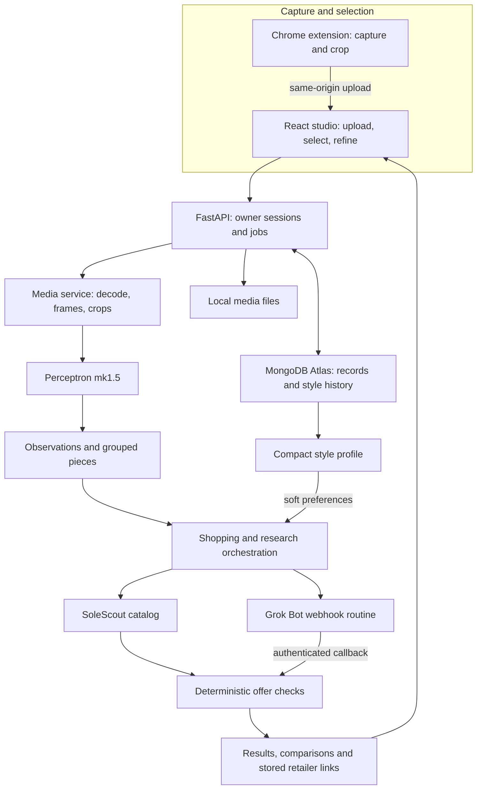
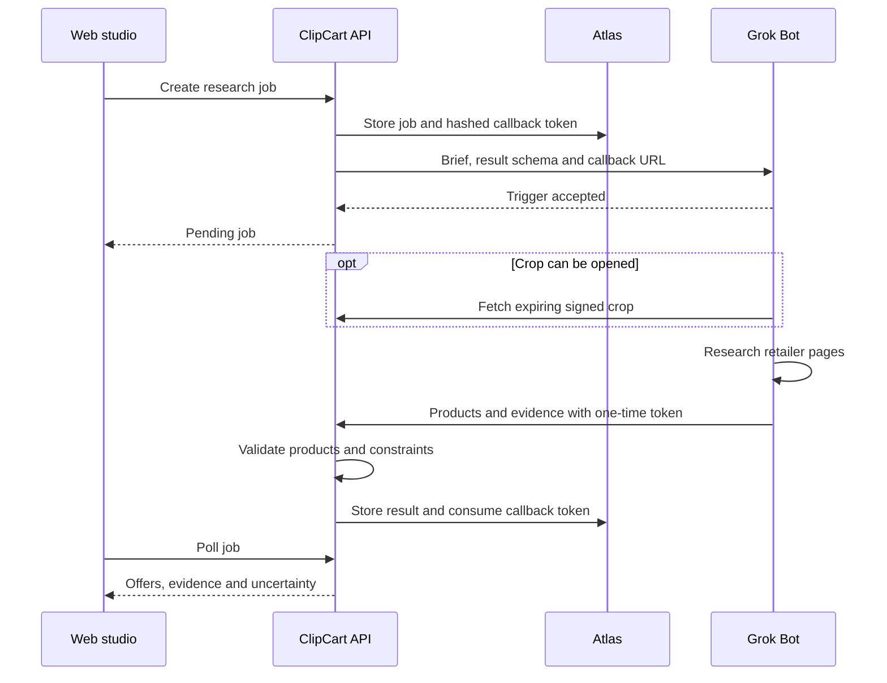

# ClipCart

> "I see it, I like it, I want it, I got it"

**Shop what you watch.**

You see a jacket in a video. The comments say "link?" and nobody has an answer. Finding it means screenshots, guessed search terms, and a lot of tabs.

ClipCart starts with the frame. Pause the video, click the Chrome extension, and crop the piece you want. Perceptron describes what is visible. ClipCart finds shopping options, checks your constraints, and remembers what you save and reject.

Built by Ashwin and Vinay at **DubHacks '26**. The working product is a web app with a Chrome extension. The Solana payment and compressed-receipt experiment is a separate devnet build pending integration review.

[Run locally](#run-it) · [System design](#system-design) · [What is verified](#what-is-verified) · [Technical contracts](#code-map)

| Start with a real clip | Find the piece | Remember your style |
|:---:|:---:|:---:|
|  |  |  |

These are development screenshots from earlier UI checkpoints. The studio and style examples use test data; they are not evidence of current retailer prices or model quality. The landing walkthrough's box is explicitly illustrative, not detection output.

## One outfit with ClipCart

**Capture the frame.** You're watching a fit check and want the jacket. Click **Shop this frame**, drag around it, then choose **Open in ClipCart**. Cropping happens in the extension before upload. The studio keeps the source page title and URL with the capture. You can also upload a photo or a short video directly.

**Pick the piece.** Perceptron finds garments and returns boxes, visible attributes and readable text. Click the jacket, or use **Find in video** to describe it. When a video match is found, the viewer jumps to its frame. If detection misses something, draw a box yourself.

**Set your rules.** Choose a budget, size, colors, condition or material exclusions. Watches and jewelry have their own category rules: a clothing size doesn't constrain a watch, and a ring gets a separate US ring size.

**Find somewhere to buy it.** The catalog search provides initial options. **Research more offers** dispatches a Grok Bot job to look across retailer and resale pages. The app shows the source, condition, availability and price evidence. A likely or similar match stays labeled that way. Opening a retailer link takes you to that retailer; ClipCart does not execute its checkout.

**Keep the useful context.** Save something you like. Hide something you don't. Your style shows preferences, evidence and a wardrobe divided into saved items, self-reported purchases, verified orders, hidden items and opened links. A click is not a purchase, and a save is not ownership.

## Built with Perceptron, Grok Bot and MongoDB Atlas

### Perceptron turns pixels into a shopping brief

The demo uses **Perceptron mk1.5** for detection and visible attributes. Media is decoded before analysis; video timestamps come from the decoder, and orientation is corrected before boxes are drawn. Observations are grouped into selectable pieces across frames.

The model supplies observations, not product identity. "Black bomber, ribbed collar, gold-tone zips" is useful search context. A small unreadable logo is not proof of a brand. Accessory descriptions use appearance such as tone and shape rather than asserting precious metals, gemstones or authenticity.

Boxes use normalized `[xmin, ymin, xmax, ymax]` coordinates with a top-left origin. Invalid boxes are rejected rather than silently clamped. Detection and attribute calls have separate limits.

Code: [`app/media`](services/api/app/media), [`providers/perceptron`](services/api/app/providers/perceptron), and the [accessory contract](docs/contracts/accessories.md).

### Grok Bot opens the shopping tabs

The shopping brief becomes an asynchronous research job. ClipCart sends the selected item's attributes, shopper constraints, soft style hints and an expiring crop link to a webhook routine. The Bot returns structured products through an authenticated callback. The webhook's initial HTTP 200 means only that the run started.

Returned products pass through deterministic checks for URL safety, category, price evidence, variants and shopper constraints. Unpriced research offers go to **Needs checking**. Offer groups distinguish shared product identifiers from approximate title/brand matches. Conditions and unavailable variants remain visible so a cheaper offer isn't presented without its qualifications.

The first real research run completed in about **110 seconds**. It used the text description: the Bot did not fetch the crop. Two returned product pages were independently confirmed and two remained unconfirmed. This is a working research example, not a claim of exhaustive retailer coverage or guaranteed exact matching. Unattended approval behavior remains unverified.

SoleScout remains the catalog fallback. Its comparison-page price is never attributed to a named retailer unless that retailer's own offer record supports it. The xAI API search workers are a separate optional path; they are not the Grok Bot routine.

Code: [`app/research`](services/api/app/research), [`app/shopping`](services/api/app/shopping), [research contract](docs/contracts/agent-research.md), and [Bot setup](docs/grok-bot-bridge.md).

### Atlas makes the wardrobe survive a restart

MongoDB Atlas stores owner-scoped sessions, preferences, search and research records, evidence, referrals and style history. Media files live in the backend's media directory; Atlas stores their records. Keeping the database alone is not a backup of uploaded media.

The style profile is a compact summary of explicit preferences and supported behavioral evidence. Repeated saves can suggest a preference; a stated correction wins. Removed preferences are protected from being inferred again. Search uses that profile as soft ranking context without relaxing budget or other hard constraints.

The demo uses the **rule-based reader**. Gemma is an optional interpretation provider that proposes structured preferences from evidence; it does not retrain its weights after each click. A hosted Gemma 3 12B experiment ran on Lambda, but that endpoint is off and model-based ranking is disabled.

Atlas acceptance passed **15/15 checks**, including owner isolation and restoration after a server restart. This was a real Atlas connection, with fixture AI providers so persistence testing did not spend model credits.

Code: [`app/style`](services/api/app/style), [`storage`](services/api/app/storage), [memory contract](docs/contracts/style-memory.md), and [Atlas setup](docs/atlas-setup.md).

## System design

The extension is a capture client. It hands the image to the same API and studio used by ordinary uploads; it doesn't run a second shopping system.



The research callback has its own lifecycle. The browser polls the job rather than waiting for the Bot to finish inside an HTTP request.



### Where the boundaries are

- **Same browser owner.** The extension opens a tab on ClipCart's origin for session creation and upload, so the app's owner cookie governs both flows. Session-resume and upload recovery handle concurrent tabs.
- **Bounded model work.** The template allows at most six detection calls and three attribute calls per upload. Live model calls cost credits; loading the landing page or cropping in the extension does not trigger them.
- **Controlled callbacks.** Crop links expire. Callback tokens are stored hashed, accepted once, and checked before results enter the normal verifier. A timeout or manual import is not presented as a successful Bot callback.
- **Evidence before claims.** Page text can support an agent-observed price. It doesn't independently prove authenticity, exact identity or future stock. Unknown material composition stays unknown.
- **Data leaves the browser deliberately.** The selected image goes to the backend and Perceptron. Grok research receives the shopping brief and can access an expiring crop link. This is not an on-device AI product.

## Solana: a separate devnet receipt experiment

The controlled demo merchant accepts **0.01 SOL on devnet**. Its verifier checks the cluster, successful transfer, exact amount, recipient, reference account, buyer source and original order-time window before marking an order paid.

That payment has been verified through live RPC. A **Bubblegum V2 compressed receipt** was also minted, and DAS confirmed the recorded buyer owns its compressed leaf.

| Evidence | Public reference |
|---|---|
| Verified demo payment | [Devnet transaction](https://explorer.solana.com/tx/3KjLMeXJUjidmxgbsvqWZQVCfHeBAupHnTk8rdc2EkNjr12A7iCCRXsgkbYqyjLVsioAPmsoDGPtA2Psz51HkbJh?cluster=devnet) |
| Compressed receipt mint | [Devnet mint transaction](https://explorer.solana.com/tx/Hfs1KdaiKLstxgXrbw7xzuiAL5CREUVFpw92pGQLdJCM6xjgiAnTadqH2WNaSwFFJKTRgvsNLwjmEDJmvim8KbD?cluster=devnet) |
| Receipt asset ID | `HEtzjRrzUzYrSo2AaQJJsb5UXAXRXb8phLBchW7KUEhq` |

**This is not released in the main app at the core release checkpoint below.** Payment, receipt and checkout UI work remain under review in [#13](https://github.com/JustGooogleIt/clipcart/pull/13), [#29](https://github.com/JustGooogleIt/clipcart/pull/29) and [#34](https://github.com/JustGooogleIt/clipcart/pull/34). Concurrency and recovery fixes must pass combined review before enabling them. The existing receipt has no authorized browser order session for the rehearsal, so its public chain evidence is separate from the protected checkout UI.

Test funds only. No retailer fulfillment. A compressed receipt does not mean ClipCart purchased an external retailer's item.

## What is verified

Checkpoint: **October 18, 2026**, core release [`9f9822f`](https://github.com/JustGooogleIt/clipcart/commit/9f9822f9d331b9149399f9b993e50e79b5c53f32). Feature availability depends on local configuration; a fresh clone does not inherit the team's keys or enabled flags.

| Area | Evidence and limits |
|---|---|
| Extension | Real user toolbar captures tested; extension unit tests 5/5 and fixture end-to-end checks 12/12. Universal site/player support is not claimed. |
| Perceptron | Live mk1.5 photo and video journeys passed. Watch/jewelry pipeline has fixture coverage; live accessory quality remains under manual validation. |
| Grok Bot | Authenticated probe callback and a real text-based shopping-research job completed. Crop-based research and fully unattended operation are not established. |
| Atlas | Real connectivity, indexes, owner isolation and restart persistence: 15/15 acceptance checks. |
| Style and wardrobe | Rule-based preferences, evidence, save/hide/undo and persistence work. Gemma is not running in the demo. |
| Core regression | Integration owner reported 427 backend tests passing at this checkpoint; web typecheck/build and generated contracts passed. Counts exclude the unmerged Solana candidate. |
| Solana | Live payment and cNFT evidence above; combined product integration remains gated. |

The committed UI screenshots and automated browser runs use clearly labeled fixtures where applicable. They do not establish live accessory recognition or real retailer inventory. We do not report an exact-match accuracy score or a general latency benchmark.

## Run it

Requirements: **Python 3.11+, Node.js 20+, npm, ffmpeg and ffprobe**. The API and built frontend share one local origin.

```bash
git clone https://github.com/JustGooogleIt/clipcart.git
cd clipcart
cp .env.example .env
# Edit .env before starting; never commit credentials.
bash scripts/dev.sh
```

Open **http://127.0.0.1:8000**. The script creates the API virtual environment, installs pinned Python dependencies, installs/builds the web app, and starts Uvicorn. On macOS, `brew install ffmpeg` supplies ffmpeg/ffprobe if missing.

Set these in `.env` for the core live demo:

```dotenv
PERCEPTRON_API_KEY=YOUR_PERCEPTRON_KEY
PERCEPTRON_MODEL=perceptron-mk1.5
CATALOG_PROVIDER=solescout
MONGODB_URI='YOUR_ATLAS_CONNECTION_STRING'
MONGODB_DB=clipcart
FEATURE_STYLE_MEMORY=true
STYLE_MODEL_PROVIDER=none
STYLE_MODEL_RANKING=false
```

Set `PERCEPTRON_MODEL` explicitly: the current template/default still names mk1. Without a Perceptron key, use manual box selection. Without `MONGODB_URI`, storage is in-process memory and does not survive a server restart. See the [Atlas guide](docs/atlas-setup.md) for the database user, IP access and connection checks.

For development fixtures, set `PERCEPTION_PROVIDER=fixture` and `CATALOG_PROVIDER=fixture` in `.env`, leave `XAI_API_KEY` empty, and keep `STYLE_MODEL_PROVIDER=none` and `FEATURE_AGENT_RESEARCH=false`. The detections and products are canned development data, not analysis of arbitrary uploads.

### Load the extension

1. Start the app.
2. In Chrome 116+, open `chrome://extensions` and enable **Developer mode**.
3. Choose **Load unpacked** and select `apps/browser-extension/`.
4. Pin ClipCart. Its default app address is `http://127.0.0.1:8000`.
5. Pause a video, choose **Shop this frame**, crop, then **Open in ClipCart**.

No extension build step is required. [Extension README](apps/browser-extension/README.md) covers permissions, custom addresses, protected/unsupported pages and troubleshooting.

### Enable Bot research and accessories

Grok Bot research needs a research webhook routine, its sender key, a public HTTPS tunnel to the API, and a callback approval rule. It does **not** require `XAI_API_KEY` for this provider.

```dotenv
FEATURE_AGENT_RESEARCH=true
RESEARCH_PROVIDER=grok_bot
GROK_BOT_WEBHOOK_URL=YOUR_RESEARCH_ROUTINE_URL
GROK_BOT_WEBHOOK_KEY=YOUR_RESEARCH_ROUTINE_KEY
CLIPCART_PUBLIC_BASE_URL=https://YOUR_API_TUNNEL_HOST
RESEARCH_URL_SECRET=YOUR_PERSISTENT_RANDOM_SECRET
FEATURE_ACCESSORY_DETECTION=true
```

Keep credentials in ignored local configuration. Follow [the bridge guide](docs/grok-bot-bridge.md) for the probe and research routine. A tunnel to the probe port cannot serve production job callbacks or crops. A configured provider remains unverified until a real job succeeds. The app also supports a labeled manual import or SoleScout research fallback.

YouTube URL ingestion is a separate optional, allowlisted path, disabled by default. The Chrome screenshot flow does not need a YouTube API key or a video download.

## Test and inspect

These commands run the automated suites, not the explicitly gated live-provider checks:

```bash
services/api/.venv/bin/python -m pytest services/api/tests -q
(cd apps/web && npm run typecheck && npm run build)
(cd apps/browser-extension && npm test)
```

Regenerate contracts after changing canonical Pydantic records:

```bash
services/api/.venv/bin/python scripts/gen_contracts.py
(cd apps/web && npm run gen:types)
```

Check persistence separately, with fixture AI providers:

```bash
services/api/.venv/bin/python scripts/atlas_acceptance.py
```

Use `#/diagnostics` for provider and storage status, `/api/health` for machine-readable health, and `/docs` for the FastAPI reference. Live smoke checks are explicit and may spend provider credits; see [`scripts/live_checks.py`](scripts/live_checks.py).

## Code map

| Path | Responsibility |
|---|---|
| [`apps/browser-extension`](apps/browser-extension) | Manifest V3 capture, local crop preview, settings and same-origin handoff |
| [`apps/web`](apps/web) | React/TypeScript studio, landing, research offers and wardrobe |
| [`services/api/app/media`](services/api/app/media) | Validation, decoding, timestamped frames, crops and grouping |
| [`services/api/app/providers`](services/api/app/providers) | Perceptron and catalog adapters |
| [`services/api/app/shopping`](services/api/app/shopping) | Bounded workers, refinement, constraints and ranking |
| [`services/api/app/research`](services/api/app/research) | Bot dispatch, signed crops, callbacks, evidence and offer comparison |
| [`services/api/app/style`](services/api/app/style) | History, preference inference, overrides and personalization |
| [`services/api/app/contracts`](services/api/app/contracts) | Canonical Pydantic API records |
| [`packages/contracts`](packages/contracts) | Generated JSON Schema and TypeScript contracts |
| [`docs/ClipCart_SRS.md`](docs/ClipCart_SRS.md) | Original system requirements |

## Who pays, and what comes next

The intended business is retailer referrals and affiliate commissions when ClipCart sends a shopper to a useful offer. Monetization is proposed, not active revenue. Creator distribution and saved looks are the route into the product; broader retailer coverage and better matching make it worth returning to.

Next: finish the integrated devnet checkout review, validate accessory detection on more real captures, improve image-based retailer matching, and evaluate model-assisted style interpretation against the deterministic baseline. Production retailer checkout and continually trained personal models are not part of this hackathon release.
